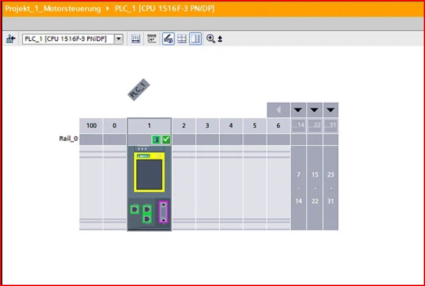
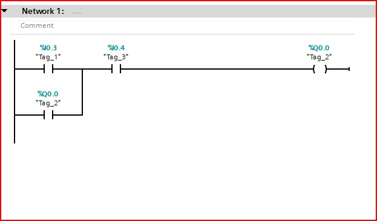
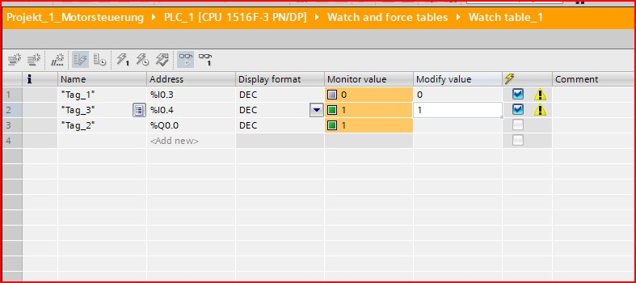
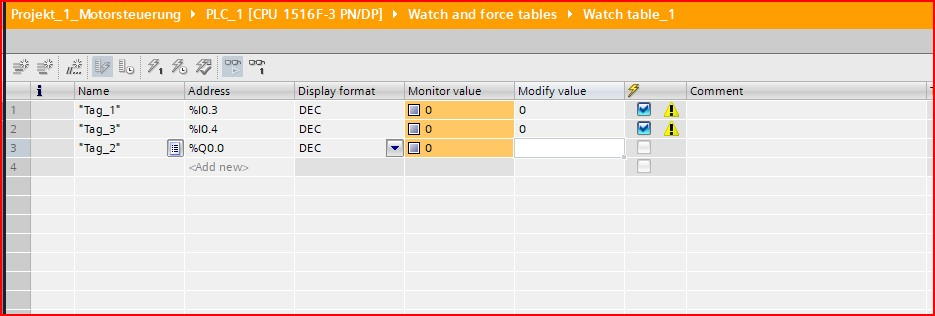

# Projekt: Motorsteuerung mit Selbsthaltung

## Kurzbeschreibung
Dieses Projekt realisiert eine klassische Motorsteuerung mit Selbsthaltung in TIA Portal. Der Motor wird über eine Start-Taste eingeschaltet und bleibt nach dem Loslassen der Taste aktiv. Eine Stopp-Taste schaltet den Motor wieder ab.

## Dokumentation
Eine vollständige Projektdokumentation (inkl. Tests und Erklärungen) finden Sie hier: 
👉 [Projektdokumentation_Motorsteuerung_Selbsthaltung.pdf](Projektdokumentation_Motorsteuerung_Selbsthaltung.pdf)

## Verwendete Hardware / Software
* **Software:** TIA Portal V19 (Trial), S7-PLCSIM V19
* **Steuerung:** SIMATIC S7-1500 (CPU 1516F-3 PN/DP)
* **Sprache:** LAD (Kontaktplan)

## Screenshots

### Hardware-Konfiguration

### LAD-Schema

### Nachweis der Selbsthaltung
Der Motor (Q0.0) bleibt auf 1, obwohl die Start-Taste (I0.3) auf 0 ist.

### Nachweis der Stopp-Funktion
Die Stopp-Taste (I0.4) unterbricht den Stromkreis und der Motor (Q0.0) schaltet ab.

